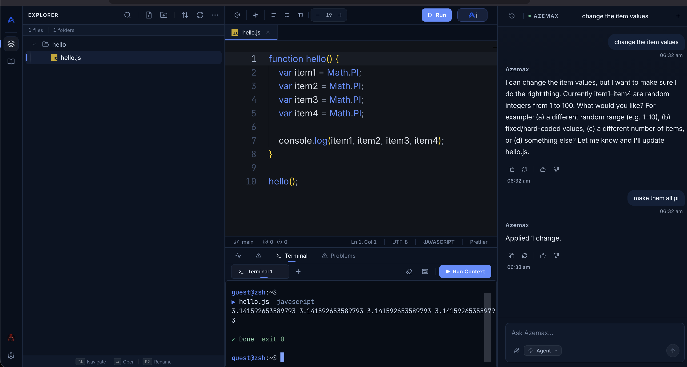
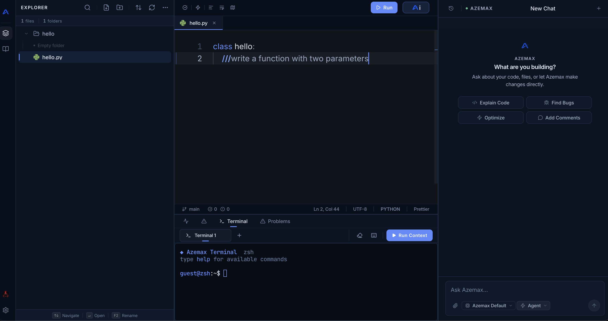
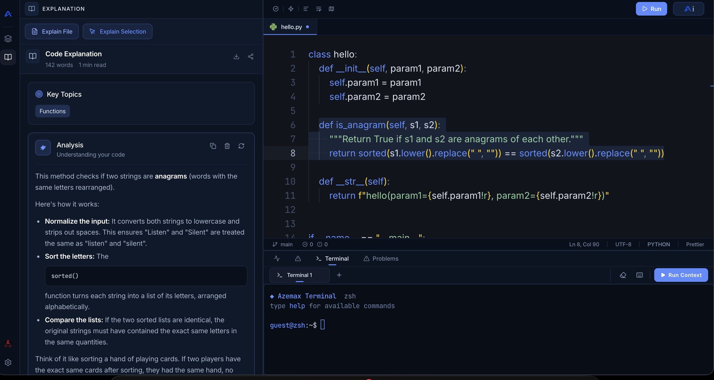
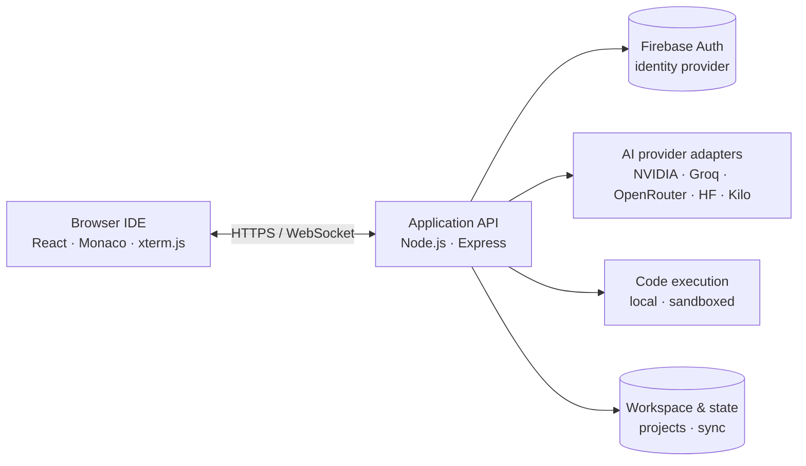

<p align="center">
  
</p>

# Azemax Studio

**Build beyond limits.**

Azemax Studio is a browser-based, AI-native coding environment. It combines a Monaco-powered editor, agentic AI workflows, an integrated terminal, and code execution inside a single authenticated workspace — no local toolchain required to start coding.

<p align="center">
  <a href="LICENSE"></a>
  <a href="https://github.com/azemaxhq/azemax-studio/actions/workflows/ci.yml"></a>
  
  
</p>

<p align="center">
  <a href="#introduction">Introduction</a> ·
  <a href="#features">Features</a> ·
  <a href="#screenshot">Screenshot</a> ·
  <a href="#architecture-at-a-glance">Architecture</a> ·
  <a href="#quick-start">Quick start</a> ·
  <a href="#contributing">Contributing</a> ·
  <a href="#license">License</a>
</p>

## Contents

- [Introduction](#introduction)
- [Features](#features)
- [Screenshot](#screenshot)
- [Architecture at a glance](#architecture-at-a-glance)
- [Quick start](#quick-start)
- [Configuration](#configuration)
- [Technology stack](#technology-stack)
- [Project structure](#project-structure)
- [Testing & quality](#testing--quality)
- [Security](#security)
- [Contributing](#contributing)
- [License](#license)
- [Documentation](#documentation)

## Introduction

**What is Azemax Studio?**

Azemax Studio is a browser-based integrated development environment built for AI-assisted software development. It runs entirely in the browser and connects to a Node.js/Express API, giving developers a code editor, an AI assistant, an integrated terminal, and the ability to execute code from one workspace.

**What problem does it solve?**

Modern development involves switching between an editor, a terminal, a browser, and one or more AI tools. Azemax Studio brings those together in a single, authenticated environment so developers can explore code, ask questions, apply AI-generated edits, run programs, and inspect results without leaving the IDE.

**What makes its approach useful?**

Editing, AI assistance, and execution share the same workspace and account state. AI provider credentials and privileged operations stay on the server, while the browser holds only a short-lived Firebase ID token. Workspaces, settings, and chat history sync per account, so picking up where you left off works across devices.

**What can developers accomplish with it?**

- Write and navigate code in a Monaco Editor with tabs, split views, and diagnostics.
- Chat with an AI assistant that knows the open file, and apply generated edits with `///` smart comments.
- Run agentic coding flows that plan, read files, and propose edits through provider tool calls.
- Execute supported languages in development (local runtimes) or a sandboxed path in production.
- Work in an integrated xterm.js terminal over WebSocket.
- Connect to multiple AI providers (NVIDIA, Groq, OpenRouter, Hugging Face, Kilo Code) with keys managed server-side.

## Features

### Intelligent coding assistance
- AI assistant panel with awareness of the open file and workspace context.
- Streaming chat responses and `///` smart-comment commands (generate, explain, fix).
- Inline code suggestions with cancellation support.
- Diagnostics rendered as Monaco Editor markers (errors and warnings).

### AI agent workflows
- Agent-driven planning and file edits through provider tool calls.
- Model routing, retry, and safety filters.
- Bring-your-own-key (BYOK) provider flows for supported models.

### Code editing & navigation
- Monaco Editor with tabs, split views, minimap, multi-cursor editing, bracket matching, and code folding.
- Language detection from file extension, formatting, word wrap, and theme support.
- File explorer workspace tree with create, rename, and delete operations.

### Workspace & file management
- Persistent projects and workspaces, scoped per authenticated account.
- Cross-device sync of settings and AI chat history.
- Local workspace with cloud reconciliation on sign-in.

### Code execution
- Run supported languages through the configured execution environment.
- Local compilers/shells enabled by default in development; sandboxed execution in production.
- Standard input (stdin) and runtime listing.

### Terminal experience
- Integrated xterm.js terminal rendered in the bottom panel.
- WebSocket-backed sessions with token-authenticated handshakes.
- Tabbed terminal sessions, stdin input, and process kill.

### Multi-provider model integration
- Server-side provider adapters for NVIDIA, Groq, OpenRouter, Hugging Face, and Kilo Code.
- API keys remain server-side; model allowlists, message/token caps, and daily quotas enforced on the server.

### Authentication
- Firebase Authentication is the only identity provider (email/password and Google).
- Verified email required for AI, execution, projects, and terminal operations.
- No guest mode, anonymous access, or auth-bypass flag.

### Security & reliability
- Server-side credentials; client-exposed variables never contain private secrets.
- CORS origin restrictions, rate limiting, and constant-shape auth failures.
- Fail-closed production configuration: the server refuses to boot without Firebase Admin configured.

## Screenshots

Azemax Studio in action: the editor, AI assistant, `///` smart comments, explanations, integrated terminal, and full workspace.

<div style="text-align: center; margin: 24px 0;">

<div style="display: inline-block; max-width: 700px; margin: 12px; text-align: left; border: 1px solid #eaeaea; border-radius: 10px; overflow: hidden; background: #fff;">
  
  <div style="padding: 10px 14px; font-size: 14px; line-height: 1.5; color: #374151; border-top: 1px solid #f0f0f0;">
    <strong>Editor</strong><br/>Monaco-powered editing with file explorer, tabs, minimap, bracket matching, and inline diagnostics.
  </div>
</div>

<div style="display: inline-block; max-width: 700px; margin: 12px; text-align: left; border: 1px solid #eaeaea; border-radius: 10px; overflow: hidden; background: #fff;">
  
  <div style="padding: 10px 14px; font-size: 14px; line-height: 1.5; color: #374151; border-top: 1px solid #f0f0f0;">
    <strong>AI assistant</strong><br/>Conversational chat panel with awareness of the open file and workspace context.
  </div>
</div>

<div style="display: inline-block; max-width: 700px; margin: 12px; text-align: left; border: 1px solid #eaeaea; border-radius: 10px; overflow: hidden; background: #fff;">
  
  <div style="padding: 10px 14px; font-size: 14px; line-height: 1.5; color: #374151; border-top: 1px solid #f0f0f0;">
    <strong>Smart comments</strong><br/>`///` commands to generate, explain, or fix code inline with streaming responses.
  </div>
</div>

<div style="display: inline-block; max-width: 700px; margin: 12px; text-align: left; border: 1px solid #eaeaea; border-radius: 10px; overflow: hidden; background: #fff;">
  
  <div style="padding: 10px 14px; font-size: 14px; line-height: 1.5; color: #374151; border-top: 1px solid #f0f0f0;">
    <strong>Explanations</strong><br/>AI-driven code explanations with surrounding context, rendered in the editor.
  </div>
</div>

<div style="display: inline-block; max-width: 700px; margin: 12px; text-align: left; border: 1px solid #eaeaea; border-radius: 10px; overflow: hidden; background: #fff;">
  
  <div style="padding: 10px 14px; font-size: 14px; line-height: 1.5; color: #374151; border-top: 1px solid #f0f0f0;">
    <strong>Terminal</strong><br/>Integrated xterm.js terminal with tabbed sessions over an authenticated WebSocket.
  </div>
</div>

</div>

## Architecture at a glance



The browser frontend and the Node.js/Express API are separate components. The browser talks to the API over HTTPS and WebSocket; provider credentials, token verification, and privileged operations belong on the server, never in client-side code. Firebase Authentication issues and verifies identity; the application stores only account-scoped metadata keyed by the verified Firebase UID.

For a deeper look at the server, routes, and services, see [docs/SERVER.md](docs/SERVER.md) and [docs/SERVICES.md](docs/SERVICES.md).

## Quick start

### Requirements

- [Node.js](https://nodejs.org/) 22 (`>=22.5.0 <25`, per `package.json` engines)
- npm
- A Firebase project for authentication (email/password + Google). AI features additionally require at least one server-side AI provider API key.

### Install and run

```bash
git clone https://github.com/azemaxhq/azemax-studio.git
cd azemax-studio
cp .env.example .env
npm ci
```

Open `.env` and fill in the development values using the example file as your guide. AI provider keys and Firebase Admin credentials are **server-only** — never commit them, and never prefix them with `VITE_`.

Start the development servers:

```bash
npm run dev
```

This starts the API on port `3001` and the Vite dev UI on `http://localhost:5173` (the `/api` path is proxied to the backend). Open `http://localhost:5173` in your browser and sign in.

> Authentication is mandatory. Without Firebase credentials configured, the server boots but the workspace stays locked — protected routes return `401` and `/api/auth/sync` returns `503`. There is no development bypass. See [docs/AUTHENTICATION.md](docs/AUTHENTICATION.md) for the authentication model (no configuration values are published here).

## Configuration

This README intentionally does not list environment variables or deployment values.

- Copy [`.env.example`](.env.example) to `.env` for local development and set only the values you need.
- Credentials must remain outside version control. `.env` is gitignored.
- Variables prefixed with `VITE_` are embedded in the frontend build at compile time and must never contain private secrets (provider keys, service-account keys, passwords).
- Server-only credentials (Firebase Admin, AI provider API keys) are read by the Node.js API and never reach the browser.

For production deployment, refer to the deployment configuration in the repository (`.github/workflows/ci.yml`, `vercel.json`, `render.yaml`) and keep all secrets out of the build output.

## Technology stack

| Area | Technology |
| --- | --- |
| Frontend | React 19, TypeScript 5.9, Vite 7 |
| Styling | Tailwind CSS, Framer Motion |
| Editor | Monaco Editor (`@monaco-editor/react`) |
| Terminal | xterm.js with fit, web-links, and webgl addons |
| Backend | Node.js, Express 5, WebSocket (`ws`) |
| AI | Provider abstraction with streaming, agent tools, and BYOK flows |
| Authentication | Firebase Authentication (client) + Firebase Admin (server) |
| Validation | ESLint, Vitest, Playwright |

## Project structure

```
.
├── public/            # Static assets (icons, logos, fonts)
├── server/            # API, middleware, services, WebSocket handling
├── src/               # React application and core editor/AI/runtime logic
├── tests/             # Vitest unit and integration tests
├── docs/              # Project documentation (auth, server, services, components)
├── scripts/           # Development and build utilities
├── .env.example       # Development configuration template
├── LICENSE            # Apache License 2.0
├── NOTICE             # Third-party attributions
├── CONTRIBUTING.md
├── CODE_OF_CONDUCT.md
└── SECURITY.md        # Vulnerability reporting
```

## Testing & quality

Run the project's checks from the repository root:

| Command | Purpose |
| --- | --- |
| `npm run typecheck` | TypeScript project references (`tsc -b --noEmit`) |
| `npm run lint` | ESLint over the project |
| `npm test` | Vitest unit and integration suite |
| `npm run build` | Production build (`tsc`, Vite, prerender) |
| `npm run test:e2e` | Playwright end-to-end suite |
| `npm run test:e2e:auth` | Fail-closed authentication end-to-end checks |

The latest verified run of this repository passed **2,244 tests across 58 test files**, with type-check and production build checks also passing. Local results from your own checkout are the source of truth as the project evolves.

## Security

- Keep provider credentials server-side; never commit `.env` or real secrets.
- The frontend must never contain private secrets in `VITE_` variables.
- Missing required production security configuration fails closed — privileged functionality does not start or run unauthenticated.
- Production code execution uses the configured sandbox; local shell/local execution is disabled in production.

If you discover a vulnerability, report it through [SECURITY.md](SECURITY.md). Do not open a public issue for security concerns.

## Contributing

Contributions, bug reports, and suggestions are welcome. Please read [CONTRIBUTING.md](CONTRIBUTING.md) before opening a pull request and follow the project's [Code of Conduct](CODE_OF_CONDUCT.md).

To get started:

1. Fork the repository and clone your fork.
2. Run `cp .env.example .env` and set the development values.
3. Run `npm run dev`, then `npm run typecheck`, `npm run lint`, and `npm test`.
4. Keep pull requests focused on one logical change and include tests where applicable.

For bug reports, include the expected behavior, actual behavior, reproduction steps, and relevant sanitized logs. Never attach credentials, private environment files, or personal workspace data.

## License

Azemax Studio is licensed under the [Apache License 2.0](LICENSE). Third-party acknowledgements and applicable attributions are listed in [NOTICE](NOTICE).

The Azemax name and logo are not granted for use by the software license; see the repository notices for applicable trademark information.

## Documentation

- [docs/DOCUMENTATION.md](docs/DOCUMENTATION.md) — technical documentation index
- [docs/AUTHENTICATION.md](docs/AUTHENTICATION.md) — authentication model and flows
- [docs/SERVER.md](docs/SERVER.md) — backend API, routes, and services
- [docs/SERVICES.md](docs/SERVICES.md) — frontend services and utilities
- [docs/COMPONENTS.md](docs/COMPONENTS.md) — React component reference
- [docs/FULL_DOCUMENTATION.md](docs/FULL_DOCUMENTATION.md) — comprehensive module reference
