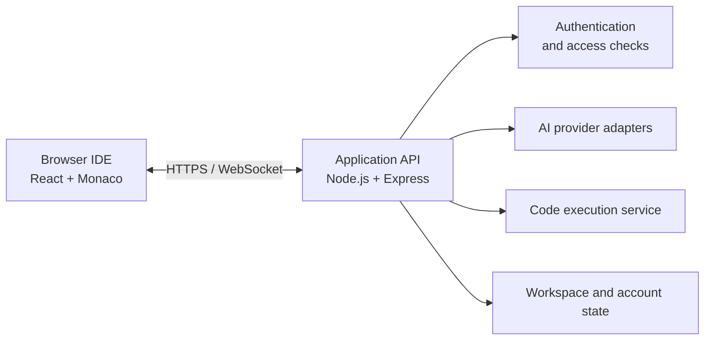

# Azemax Studio

**Build beyond limits.**

Azemax Studio is a browser-based, AI-assisted development environment that brings a modern code editor, agentic coding tools, a terminal, and code execution into one workspace.

<p align="left">
  <a href="LICENSE"></a>
  <a href="https://github.com/azemaxhq/azemax-studio/actions/workflows/ci.yml"></a>
  
  
  
</p>

## Overview

Azemax Studio combines an editor and AI development workflow in a single browser-based workspace. Use it to explore code, ask questions about a project, make edits with AI assistance, and run supported languages from the same environment.

### Highlights

- **A capable editor** — Monaco-powered editing with tabs, split views, minimap, multi-cursor editing, bracket matching, and code folding.
- **Agent-assisted coding** — Ask for explanations or changes, inspect project files, apply edits, and use diagnostics as part of an iterative workflow.
- **Flexible AI providers** — Provider adapters support NVIDIA, Groq, OpenRouter, Hugging Face, and Kilo Code.
- **Code execution** — Run supported languages through the configured execution environment, with sandboxed execution for production use.
- **Integrated terminal** — A terminal-style workflow with WebSocket support; shell capabilities are restricted in production.
- **Persistent workspaces** — Organize project files, search and edit code, and sync supported account state across sessions.
- **Security-minded defaults** — Server-side provider credentials, request validation, access checks, origin restrictions, and fail-closed production configuration.

## Technology

| Area | Technologies |
| --- | --- |
| Frontend | React, TypeScript, Vite, Tailwind CSS |
| Editor | Monaco Editor |
| Backend | Node.js, Express |
| Terminal and transport | xterm.js, WebSockets |
| AI | Provider abstraction layer, streaming responses, agent tools |
| Validation | TypeScript, ESLint, Vitest, Playwright |

## Architecture at a glance



The frontend and backend are separate components. The browser communicates with the application API; provider credentials and privileged operations belong on the server, not in client-side code.

## Quick start

### Requirements

- Node.js 22 LTS
- npm
- An identity-provider configuration for authentication
- At least one supported AI provider credential for AI features

### Run locally

```bash
git clone https://github.com/azemaxhq/azemax-studio.git
cd azemax-studio
npm ci
cp .env.example .env
```

Open `.env` and fill in the required development settings using the example file as your guide. Configure authentication for your own development project and place AI provider credentials in server-side variables only. Never commit your real `.env` file.

Start the development environment:

```bash
npm run dev
```

By default, the Vite development UI is available at `http://localhost:5173`. The development command starts the API and UI together. The IDE requires successful authentication; if required authentication configuration is missing, access remains locked rather than bypassing authentication.

## Common commands

| Command | Purpose |
| --- | --- |
| `npm run dev` | Start the API and frontend development servers |
| `npm run server` | Start the API in watch mode |
| `npm start` | Start the API process |
| `npm run build` | Run the production build |
| `npm run build:analyze` | Generate a bundle analysis report |
| `npm run preview` | Preview the frontend build locally |
| `npm run typecheck` | Run TypeScript checks |
| `npm run lint` | Run ESLint |
| `npm test` | Run the Vitest test suite |
| `npm run test:e2e:auth` | Run authentication-focused end-to-end checks |
| `npx playwright test` | Run Playwright tests; some authenticated tests require test credentials |

## Project layout

```text
.
├── public/                 # Static assets
├── server/                 # API, middleware, services, and WebSocket handling
├── src/                    # React application and core editor/AI logic
├── tests/                  # Unit and integration tests
├── docs/                   # Project documentation
├── scripts/                # Development and build utilities
├── .github/workflows/      # Continuous integration workflows
├── .env.example            # Development configuration template
├── .env.production.example # Production configuration template
├── LICENSE
├── NOTICE
├── CONTRIBUTING.md
├── CODE_OF_CONDUCT.md
└── SECURITY.md
```

## Security principles

- **Keep provider credentials server-side.** Do not place AI provider keys in client-exposed variables or commit credentials to source control.
- **Use your own development configuration.** The example environment files are templates, not working credentials.
- **Enforce access checks.** Protected API operations must verify identity and enforce authorization at the server boundary.
- **Fail closed.** Missing required production security configuration should prevent privileged functionality from starting or being used.
- **Keep execution isolated.** Production code execution should use the configured sandbox; local shell and local execution capabilities must remain disabled in production.
- **Report vulnerabilities responsibly.** See [SECURITY.md](SECURITY.md) for the reporting process.

Before opening a pull request, run the relevant type, lint, test, and build checks. Do not include `.env` files, credentials, user workspace data, build output, or private logs in commits.

## Testing

The current repository audit recorded **2,244 passing Vitest tests** across 58 test files, alongside passing type-check and production-build checks. Run the commands below to verify the state of your own checkout:

```bash
npm run typecheck
npm run lint
npm test
npm run build
```

Test results can change as the project evolves; local results from your checkout are the source of truth.

## Contributing

Contributions, bug reports, and thoughtful suggestions are welcome. Please read [CONTRIBUTING.md](CONTRIBUTING.md) before opening a pull request and follow the project's [Code of Conduct](CODE_OF_CONDUCT.md).

For bug reports, include the expected behavior, actual behavior, reproduction steps, and relevant **sanitized** logs. Never attach credentials, private environment files, or personal workspace data.

## License and acknowledgements

Azemax Studio is licensed under the [Apache License 2.0](LICENSE). Third-party acknowledgements and applicable attributions are listed in [NOTICE](NOTICE).

The Azemax name and logo are not granted for use by the software license; see the notices in the repository for applicable trademark information.
